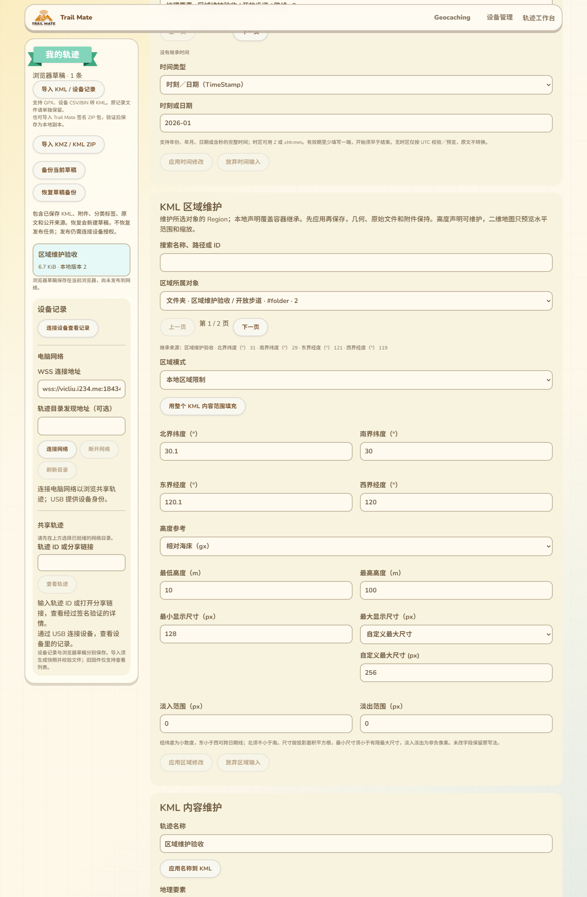
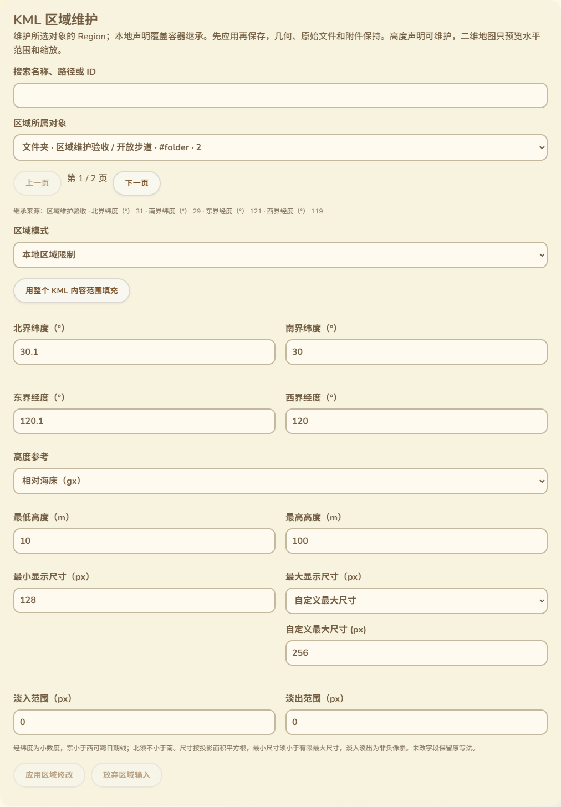

# KML 区域声明维护

2026-10-14，接90。本批把Region从按原声明预览推进到作者可维护：在现有轨迹工作台编辑水平边界、高度参考／范围、显示尺寸及淡入淡出，支持继承、显式结构补齐、应用／撤销／保存重开。只改网页、测试和CI，无固件源码、SDK构建、刷入或设备RAM增加。90中的三维预览限制保持，不把声明维护等同三维渲染或整个KML交付完成。

## 位置与录入

卡片位于时间维护下方、KML内容维护上方，沿用现有主题。对象类型、名称、完整路径、ID和原顺序编号显示在选择器中，名称／路径／ID可搜索，每页50项；当前对象不在搜索或分页结果中也保留，选择地理要素与内容维护同步。八类对象支持声明维护：Document、Folder、Placemark、GroundOverlay、NetworkLink、ScreenOverlay、PhotoOverlay和gx:Tour。后四类中未支持的显示／播放仍保留，维护Region不代表已渲染它们或已访问NetworkLink。

“本地区域限制”显示北／南纬度、东／西经度、五种高度参考与高度上下限、最小／最大显示尺寸及淡入淡出像素范围。最大尺寸不把-1当裸数字给用户；显示为“没有最大尺寸限制”或“自定义最大尺寸”，后者才出现数值框。所有数值标明单位，支持本地小数分隔符、阿拉伯／波斯／全角数字及负号；仅转换用户编辑的字段，未编辑XML写法保留。错误原输入及其录入语言在切换界面语言后保留。

“用整个KML内容范围填充”只填四个水平边界，明确指全部文件内容；不修改实际几何，也不补造高度。日期线及±180完整世界边界保持。继承来源显示父容器和原边界，父声明无效时说明可选择对应容器修正。

## 应用、继承与结构修复

输入先应用到编辑稿，再使用工作台保存。未应用输入锁住保存／下载／撤销、其他编辑表单、附件和发布准备，退出保护沿用已有流程；可以放弃输入。应用后的修改可精确撤销，保存后刷新重新打开仍保留。

恢复继承移除本地Region及其全部内容，先确认恢复操作，再按需列出会删除的属性／ID／扩展／注释，最多列32个不同项目并给总数。若仍有其他XML节点targetId引用被删除的对象或子对象，则禁止操作。原始导入文件和附件不变。

缺少必需LatLonAltBox／Lod／minLodPixels等结构可由作者明确补齐；不会仅因打开表单就修复。重复Region、重复已知节点、日期／数值节点含元素子结构或重复高度模式则拒绝猜测，保留原文。无效源不强制产生编辑状态，用户仍可选择其他对象；显式补齐后也可放弃。

完全等值的合法输入无需XML重写，UI显示原文件保持，不产生待保存修改或撤销历史。不同字符串如128与128.0数值相同，原字节仍保留；真正的缺结构修复不被误判为无操作。

## 内容保留与命名空间

修改Region保留原Region／LatLonAltBox／Lod／数值标量的属性、ID、CDATA、注释和未知扩展；几何、TimeStamp、样式、Icon、附件与原稿保持。只修改实际变化的数值，默认可省略字段继续省略，缺失的必需字段才创建。新声明遵循Feature顺序，盒与Lod及其扩展也按原语顺序插入。

高度模式可在KML与gx命名空间之间切换，已有属性和ID保留；若切换会影响目标ID引用则禁止。同一命名空间内改变模式值允许，仍保留引用。新Region在有前缀和gx:Tour等不同命名空间父对象中均验证正确；本批不新增设备上的高度模型。

## 验证与后续范围

- 28项相关Node／原生日期退出0，包含3项新编辑验证：完整声明／无效输入、日期线与完整世界填充、40键11语言目录及提示。其他区域预览、时间维护／筛选、回放、高程和叠加测试保持。
- 新实际Edge整页退出0：真实浏览器XML序列化、八类对象顺序、命名空间与ID／属性／CDATA／注释、七种拒绝操作、原扩展／几何／时间／样式保留、源模型未被直接修改。
- 实际表单覆盖11语言390px／RTL、错误原输入保留、德国小数输入切英文后正确应用、其他编辑互锁、无限／有限尺寸、确认取消／接受、精确撤销、IndexedDB版本一次递增及刷新重开；原导入KML和PNG字节保持。
- 补充实际UI覆盖无操作时保存与历史保持干净、搜索／分页／ID显示及地理要素同步、填充范围新增Region再撤销、显式补齐／放弃且不自动保存、targetId引用的命名空间切换拒绝及歧义源保护。
- 原时间维护、图片叠加编辑、样式编辑和完整工作台浏览器回归全部退出0。网页构建、语法、差异及两张最终截图已检查，CI新增编辑测试，尚未远端运行。
- 首轮检视纠正复用时间文案导致的对象／歧义标签，增加独立区域提示；最大尺寸模式与数值框使用不同可访问名称，无操作提示采用状态语义。没有更改串口／保存协议来满足UI测试。

Region的二维预览与声明维护现均有验证，但其他高级KML、真实Wio发布恢复／WebSerial、公网目录、完整配置实际消费及SD故障掉电／导航／峰值／跨板型继续按16推进。最后只读端口枚举COM69，候选a29669a2…／已刷备份7c317f32…SHA保持，约87K／297K仍是已刷版本此前用户反馈，没有新的候选运行测量。
