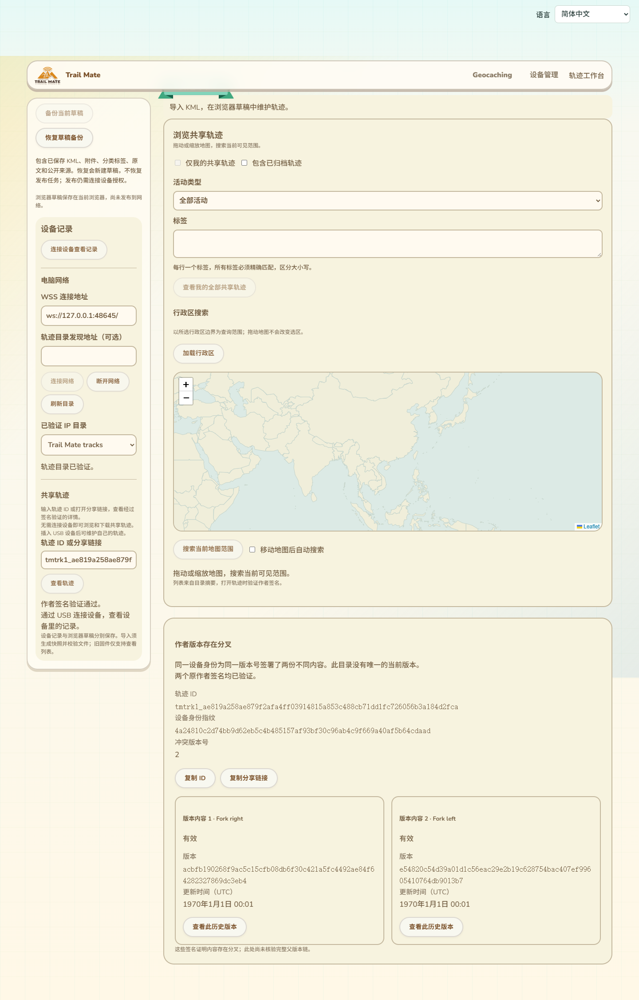
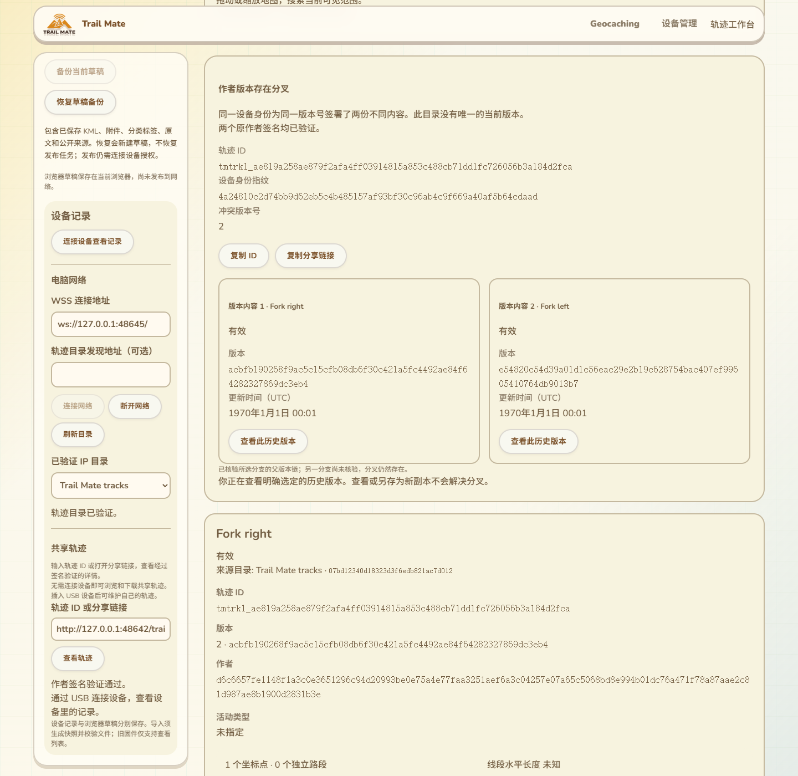

# 共享轨迹分叉证据与历史版本交互

2026-10-14，接94、95。把网络操作18的分叉引用接入现有轨迹工作台：浏览器独立验证两份原作者签名，呈现无唯一当前版本的状态，允许明确选择历史版本、下载原文件和保存可编辑副本。没有固件源码、USB命令、SDK编译、刷入或设备RAM变化。

## 页面位置与用户操作

沿用当前GitHub Pages的导航、配色、字体、圆角和两栏布局。左侧仍是设备记录、电脑网络连接、目录选择和轨迹ID／分享链接查询；右侧现有共享浏览地图下方的详情容器新增分叉卡片。

1. 输入稳定轨迹ID查询时，若目录声明支持18，先读取分叉引用。有分叉时展示两份已验签内容，不自动选当前版本，不自动下载文件。
2. 卡片显示稳定ID、设备身份指纹、冲突版本号。两份内容并列展示标题、纯文本说明、活动／归档状态、版本hash和UTC更新时间；提供复制ID、复制稳定分享链接。
3. 点击某一内容的“查看此历史版本”，使用精确版本hash继续读取。原分叉卡片保持，详情明确说明选择历史版本不会解决分叉。
4. 可以下载已验证KML、校验完整附件包、保存新的本地可编辑副本。已有设备作者即使匹配，也不在此状态提供更新／归档当前共享轨迹的入口。
5. 签名或绑定错误显示验证失败，不展示可接受分支。旧目录不支持证据读取但报告分叉时，显示尚未取得证据，可重试或换目录。更换目录／epoch或断开连接，清除旧详情和分叉证据。

新增12条文案覆盖现有11语言；阿拉伯语RTL与390px布局通过。hash和ID保持LTR、可换行；窄屏两份内容改为上下排列。完整父版本链未在此卡片核验，界面明确说明，不能把“两份签名有效”扩大为全部历史有效。

## 协议与信任边界

网络18请求为`[objectId32]`，响应为空或`[objectId32, revisionHashA32, revisionHashB32]`。此处18是轨迹网络操作，不是USB操作。浏览器读取适配器仍绑定选定目录公钥、delivery、epoch、网络generation和请求；没有为页面开放复制清单17或发布操作7。

目录签署回复只提供引用。浏览器分别用操作2读取两份精确签名manifest，验证：

- 返回objectId与查询一致，每个revisionHash与引用一致，两个hash不同。
- 两份原作者签名有效，作者公钥、对象nonce和版本号一致，manifest内容不同。
- 身份指纹由作者公钥计算；标题和说明按纯文本显示，不加载其中的HTML或外部地址。

选择历史版本后`current=false`。完整包下载结束时即使目录再次返回`current=1`，也不覆盖分叉状态；读取和另存副本都不能修改原共享记录。USB身份只用于已有作者授权流程，公共浏览不要求连接设备，也不依赖设备当前RF模式。

## 共享副本命名修正

实际整页测试发现：KML没有内嵌名称时，共享副本使用长ID文件名而非作者签名标题。工作台现在先验证共享manifest，再采用其标题作为草稿显示名称；普通文件导入仍使用KML名称／文件名。现有32字符显示预算、KML原字节、附件和来源签名保持；修改本地草稿不会改写原共享内容。

修改前对`TrackSharedRead`、读取适配器、`loadPackage`、工作台`importFile`及相关测试执行GitNexus影响查询。新增符号未收录，结果UNKNOWN，不能解释为零影响。人工核对直接调用：设备记录面板到共享读取／详情portal、IP只读适配器、完整包和草稿导入。相应签名、读取、完整包及工作台回归作为验证依据。

## 验证记录

- 6项分叉专项与原IP读取适配器2项通过：两份实际作者签名；错误对象、hash、重复引用和坏签名拒绝；普通父子版本不能冒充分叉；取消；目录能力／只读操作限制；11语言文案完整性。
- 实际组件Edge测试通过：两份实际作者签名、合成USB作者证明、受控认证网络边界；v2必需附件包、目录反复返回current=1、精确原文／签名／附件副本、坏证据／取消重试／迟到回复、旧目录无18、剪贴板、纯文本、11语言／RTL／390px。此项不当作真实USB或真实网络证据。
- 工作台IndexedDB／保存／编辑／未保存保护／移动布局、KMZ整页11语言／原文保留、原共享完整包11语言／原子副本／索引归档／安装回归通过。
- 真实两目录测试通过（33.390秒）：中途停止／重启副本后复制v1与v2共9版本，包括v2作者分叉；实际关闭并核对源端口后，新Edge独立读取归档、3／2／1历史、精确16502字节KML、索引和PNG。随后实际`site/tracks/dist`整页连接副本，显示两份原作者证据，选择历史版本、校验必需包、保存草稿、断开清理详情、刷新重开。独立读取IndexedDB，重新验证来源签名、对象／版本／标题及KML摘要和附件。此项没有替代网络回复，也没有USB；本机证据不当作公网／实机验收。
- 网络证据保存在`.codex-build/hostlink-codec/track-replication-network/result.json`及`browser/result.json`，其中`sourceOffline=true`、`versions=9`、`productionPage=true`；覆盖95六版本中间结果，95原验收记录仍作为历史保留。
- 补充可读整页截图并把刷新后草稿核验结果写入`productionCopy`后，整条真实网络测试再次通过，29.209秒退出0。独立持久图片摘要与原PNG一致，来源对象／版本／标题及KML摘要保留。全部子进程已退出，未残留本轮目录服务。
- 网站构建与`git diff --check`通过，新增专项接入CI，未宣称远端CI已运行。

## 实际截图

真实轨迹构建页面，读取本机Reticulum副本目录；源目录已停止。这两张包含现有导航和页面位置，不是重新设计的独立原型。测试作者名称和1970年时间戳是隔离fixture数据。

组件测试另保留[证据卡片](images/track-conflict-evidence-zh-Hans.png)和[历史详情](images/track-conflict-historical-zh-Hans.png)，只用于补充受控边界交互，不代替整页网络验收。

## 仍保留的交付范围

本批没有新增自动合并或由目录选赢家的规则；复制多个已知分支不证明全网没有其他分支，单节点回执不证明全网已保存。公网NAS／Linux容器／生产行政区数据、大包吞吐与多peer公平性、真实掉电／存储故障、候选固件刷入与Wio作者发布恢复、完整配置实际消费和其他高级KML能力仍按16推进。

候选`a29669a2…`仍未刷入；已刷`7c317f32…`和用户确认的约87K／297K继续作为实机基准，不把本批电脑侧改动当作新的RAM测量。
