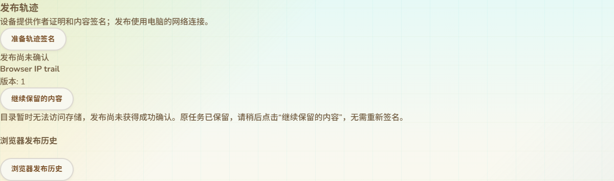

# 网页目录存储提示与原请求恢复

2026-10-14，接97。为已实现的目录存储失败响应补齐网页可理解提示、保留发布恢复操作，并验证真实Reticulum错误往返。公共协议和设备固件没有改动；无SDK编译、刷机或设备RAM增加。

## 网页行为

轨迹客户端仅把经过既有目录认证与请求关联、且响应为`503 ["storage unavailable"]`的错误转换为`TRACK_DIRECTORY_STORAGE_UNAVAILABLE`。其他503、超时、422和未知诊断保持原分类；Geocaching客户端未修改。

- 发布遇到此错误后，保持既有`unconfirmed`任务、原签名、原请求ID和目标目录。页面说明尚未获得成功确认，提示稍后使用现有继续按钮，无需重新签名。恢复时沿用原任务，不能换目录后冒充同一已确认发布。
- 共享ID读取、地图查询、附件包读取显示“目录暂时无法访问存储。请稍后重试，或选择其他目录。”，可继续使用已有重试／查询入口。
- 读取失败不展示未验证的新详情；地图查询失败清除本次结果；附件失败不提供可接受的完整包。恢复成功后仍须通过原签名、文件hash及索引校验。
- 语言切换只改变显示文字，不自动重新发布、下载、签名或写入设备。11语言均有独立文案，阿拉伯语RTL与390px布局验证通过。

修改前对轨迹客户端、IP读取适配器、发布、共享读取／地图／附件面板及测试执行GitNexus上游影响查询。新增符号未收录，结果UNKNOWN；人工范围为四种网页呈现及继承自公共客户端的轨迹请求路径。没有把风险UNKNOWN解释为零调用。

## 发布交互证据

实际生产发布组件、真实作者／目录签名、IndexedDB草稿和既有任务日志参与浏览器测试；USB和网络响应边界受控。

1. 首次提交得到受控存储503，保留未确认任务和签名。11语言提示均引用当前实际继续按钮名称；窄屏无横向溢出，语言切换不增加提交或签名。
2. 刷新页面、读取原任务后重试；第二次模拟回执丢失，仍保留未确认任务。
3. 再次重试收到有效目录回执。三次提交使用同一个请求ID，作者签名仅一次；身份代次读回变化不触发重新签名。
4. 原有准备确认、未完成任务编辑／删除保护、跨页锁、历史新副本恢复、确认后编辑与11语言验证继续通过。

截图是生产组件在受控测试页中的实际呈现，复用现有主题；不当作完整生产页面或真实USB截图。现有页面中的共享详情位置仍见96整页截图。

## 读取与地图证据

原分叉／完整包组件浏览器测试新增存储失败：操作18失败时没有详情或分叉卡；重试后可验证两份原作者证据。历史附件读取失败显示各语言可理解提示，不增加语言切换请求；恢复后原KML、来源manifest及必需附件精确保存。地图查询失败清除结果并显示提示，重试空结果成功。原坏签名／迟到／取消／旧能力、剪贴板、11语言RTL和移动布局继续通过。

Node共14项相关测试通过，包括新增4项错误分类／客户端参数保留／只读适配器／11语言文案，原签名、IP读取、上传及未确认日志恢复。原共享IP浏览、原完整包／原子副本／来源／安装及11语言浏览器回归通过。网站构建和差异检查通过。

## 真实网络故障往返

新增隔离原生目录、实际RNS／LXMF、packet bridge和新Edge客户端测试。测试worker把真实BlobStore SQLite设为只读，通过本地标记恢复写入；故障和恢复开关只在测试模块，生产服务没有此入口。网络解码、签名、来源认证、目录能力和生产请求分发未替换。

- 三次上传准入实际返回503；浏览器生产客户端将认证响应转换为新错误码，目录在此期间仍提供正常能力查询。
- 同一固定请求ID随后成功两次，获得同一上传；失败时没有未登记空文件累积。
- 完成原文件块、封存和读取，摘要一致；服务仍运行，目录公钥和epoch保持。
- 测试3.935秒退出0，所有子进程结束。证据在`.codex-build/hostlink-codec/track-storage-network/result.json`、`browser/result.json`和`service.log`；日志记录同ID的503／503／503／200／200，无文件token、正文或私钥。

此项证明真实只读数据库错误经网络到浏览器及原上传恢复；没有发布作者轨迹，不代替真实Wio签名／发布验收，也不当作物理磁盘满或公网TLS部署证据。

正常两目录复制9版本／中断重启／源TCP关闭、实际构建页面读取分叉与历史附件、保存副本和刷新IndexedDB复核再次通过，32.978秒退出0。已有复制协议没有因错误分类改变。

CI加入新增Node专项与原生网络故障测试，既有发布和分叉浏览器脚本包含新增交互；尚未远端运行。

## 仍待完成

候选Wio固件刷入／真实设备作者发布恢复、公网NAS／Linux容器与行政区数据、多个目录检索合并、完整父链验证、最大文件／包吞吐与长期多peer／掉电故障、完整配置实际生效及其他高级KML能力继续按16推进。新存储提示不代表这些范围已交付，也不改变单目录回执的证明范围。
