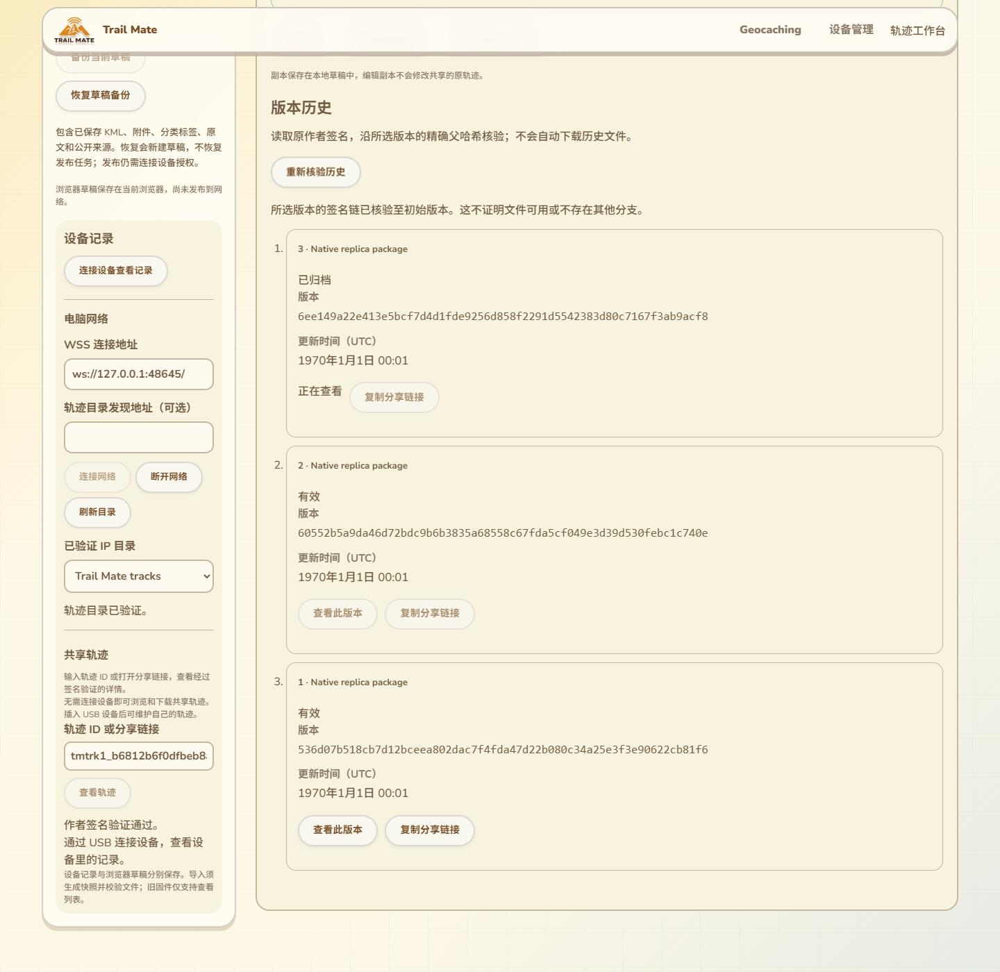

# 共享轨迹历史与完整签名路径

2026-10-14，接96—98。现有共享详情新增版本历史：按精确父版本hash读取并逐项验证原作者签名和后继关系，可打开、分享指定历史版本。只修改网页与验收脚本，不增加网络操作或USB命令，没有固件／SDK／刷入／设备RAM变化。

## 页面位置与交互

历史区位于现有共享详情的下载／副本操作之后、作者维护入口之前，复用当前主题、导航和两栏布局。点击“读取并核验历史”后才读取元数据，不自动下载KML或历史附件。

- 从正在查看的版本向父版本排列，展示版本号、标题、活动／归档状态、完整版本hash与UTC更新时间。
- 当前所选行标记“正在查看”，其他行可打开为历史详情。每行可复制含精确`rev`的分享链接，稳定轨迹ID继续复用现有入口。
- 读取过程中展示已验证数量并可取消。缺父版本、达到预算、取消、签名／后继关系无效和存储失败分别呈现；只保留已验证部分，不显示完整链成功。
- 重新核验、切换目录／epoch、断开连接与新版本选择沿用原会话代次保护，迟到结果不能进入新的详情。
- 历史打开、下载和完整包读取保持`current=false`；即使目录对精确历史返回current=1，也不会恢复更新／归档入口。
- 分叉详情完成所选历史链核验后，卡片明确只验证了所选分支，另一分支仍未核验，分叉没有解决。

15条独立文案覆盖现有11语言，阿拉伯语RTL与390px通过。语言切换不重新请求、签名或写设备。本地任务历史原模块／文案继续保留；网络作者版本历史使用独立模块，二者用途不同。

## 协议与验证范围

复用轨迹网络操作2：`[objectId32, parentRevisionHash32]`。适配器仍认证目录公钥／delivery／epoch、关联请求并核对网络generation；不增加复制清单、上传、发布或串口请求。

先重新验证当前所选manifest，再核对其objectId和revisionHash；每次父请求只使用已验证子版本声明的精确hash。父原签名与响应绑定通过后，复用`verifyTrackSuccessor`核验同对象、连续版本号、精确父引用、创建时间不变、更新时间不回退、归档不得重新激活、归档保留KML／附件和格式不得降级。只有抵达合法首版，才标记所选签名路径完整。

单次预算最多64个版本，含已在详情中的起点；最多63次父元数据请求。超过预算明确标记尚未抵达初版，不自动无限拉取。进度输出复制签名数据与数组，界面消费不能改写内部验证状态。

完整签名路径不证明历史文件仍可取得、不证明没有其他分支，也不是目录当前头或全网保存证明。其他分支以及超过本次预算的更长路径仍不能标记已核验。文件下载保留原hash／索引校验路径。

修改前对共享详情、lookup／loadPackage、分叉卡片、新读取器及验收脚本执行GitNexus影响查询；新符号未收录，结果UNKNOWN。人工核对范围为详情加载、精确历史打开、完整包current状态与分叉呈现；相应生产模块和真实网络回归作为证据。

## 自动验证

- 8项新Node测试通过：v1→v2→归档到根、首版本地重新验签／零网络、错误父／签名／响应不得进入前缀、已签名但后继关系非法、缺父与其他错误区分、实际65版触发64预算且只请求63父、取消／进度输入隔离、11语言完整文案。
- 与分叉、IP适配器和存储错误测试组合共20项通过。旧验证器与协议没有另造较宽松规则。
- 实际生产组件Edge测试通过：三版元数据仅操作2、无文件下载和额外USB；11语言／RTL／390px；精确ID＋rev剪贴板；拥有作者身份的当前版有维护入口，历史版在下载／完整包current=1后仍无维护入口；缺父、坏签名、存储错误、取消／重试、目录epoch切换与迟到结果。USB／认证网络边界受控，不当作Wio证据。
- 原分叉／存储提示、共享IP地图／详情／KML／副本、完整包／原索引归档／安装及11语言回归通过。构建、差异通过，新增Node与浏览器专项加入CI，尚未远端运行。

## 真实目录与实际页面

两真实Reticulum目录完成中断重启和9版本复制后，实际停止源TCP。新Edge从副本读取原归档v2包，由生产历史读取器验证3→2→1至根；实际`site/tracks/dist`页面读取同一轨迹历史、打开精确第二版，再读取分叉、核验所选2→1路径并展示另一分支未核验的说明。原必需KML／索引／PNG下载、持久副本和刷新IndexedDB复核继续通过。

完整流程34.535秒退出0。证据在`.codex-build/hostlink-codec/track-replication-network/browser/result.json`：`historyChainVerified=true`、`productionHistoryVerified=true`、`forkSelectedHistoryVerified=true`，同时`fork.chainVerified=false`仍表示仅分叉证据读取器没有核验双方父链。没有把这两种范围混同。

最初整页测试因为新增历史行也含轨迹标题，旧宽泛heading定位发生严格模式冲突；定位改为详情h4后通过。Windows子进程输出显式UTF-8，避免GBK错误遮蔽中文诊断。这些是测试修正，没有放宽版本验证。

截图核对后补齐历史区自身的排版边界，并让独立截图视口容纳整个历史区。最终组件／窄屏复测通过；实际两目录与完整页面再次通过，33.779秒退出0，全部子进程已结束。

截图来自实际构建页面和真实本机副本，包含现有导航／设备与网络侧栏。英文标题和1970时间是隔离原生fixture数据。补充[中文样例组件截图](images/track-version-history-zh-Hans.png)用于查看字段排布，不作为完整页面或真实USB证据。

## 仍保留的交付范围

真实Wio作者发布／恢复与候选刷入、公网NAS／Linux容器／生产行政区数据、多个目录检索合并、其他分支及更长历史路径、最大文件与包吞吐／长期多peer／物理掉电故障、完整配置实际消费与其他高级KML能力继续按16推进。设备RAM仍以用户验收的约87K／297K为基准；本轮没有新的运行RAM测量。
