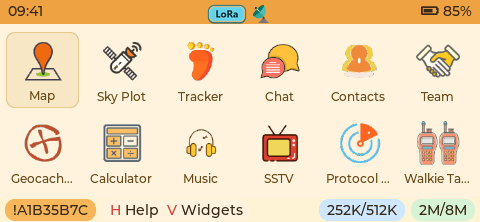
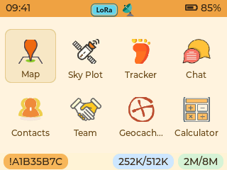
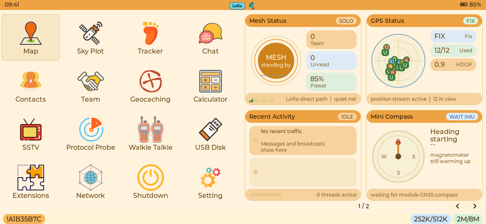
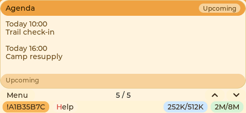

# Menu widget pages

Pager, T-Deck and Wio Tracker L2 share the same adaptive launcher grid. The
76-pixel-high cards use a 72-pixel minimum width and wrap according to available width: six columns on the
480-pixel Pager and four on the 320-pixel T-Deck/L2. Overflow scrolls vertically.
Pager no longer uses a separate large-card carousel.

Column widths divide the available width equally after reserving inter-column
gaps. Indivisible pixels are split between the outside margins, keeping their
difference within one pixel. Incomplete rows retain the same column tracks.
Keyboard focus uses a pale rounded tile with an inset border; the launcher
starts below the top bar with an explicit gap. The compact viewport contains
whole rows and centers them vertically between the top and bottom bars.

## Navigation

| Surface | Input | Result |
| --- | --- | --- |
| T-Deck/L2 launcher | Swipe right | Open the negative screen |
| Negative screen | Swipe left, D, Right, Escape or Back | Return to the launcher |
| Negative screen | Swipe up/down, W/S, Up/Down | Next/previous widget |
| Pager launcher | W/A/S/D | Move through the icon grid; A at the left boundary opens the negative screen |
| Pager launcher | Encoder rotation | Change the focused application icon |
| Pager negative screen | Encoder rotation | Next/previous widget |
| P4 right dashboard | Swipe left/right | Next/previous widget page |

The negative screen shows exactly one widget: Mesh, GPS, Recent Activity,
Compass or Agenda. Navigation stops at the first/last widget. P4 keeps the
left launcher and displays four status widgets on its first right-hand page,
then Agenda on the second. Footer controls provide a visible alternative to
gestures. Widget browsing does not activate a background launcher icon.

A drag is owned by its original menu gesture until physical release. Leaving
the initially pressed control is not cancellation of that gesture. Recognized
swipes cancel the original click before replacing any controls. App screens,
sleep scenes and modal focus groups retain their own input ownership.

## Widget boundaries

- `dashboard_widget.h` defines the root/refresh handle, strict external-memory
  allocation and DELETE ownership. It contains no service data.
- Each `dashboard_*_widget.cpp` owns its private state, child controls, data
  reads and cleanup. No widget accesses `DashboardUi` or another widget's state.
- `menu_dashboard.cpp` owns selection, arrangement, gestures and one refresh
  timer. `dashboard_state.*` retains only this container's state in PSRAM.
- Widgets read the existing GPS, messaging, mesh, orientation and Agenda ports.
  They create no service tasks, persistent stores or duplicate background caches.
- The target composition explicitly binds its `IAgendaSource`. T-Deck, L2 and
  Pager bind the existing Agenda model. P4 currently has no Agenda composition;
  its page reports that capability as unavailable until one is bound. Preview
  Agenda data is supplied only by a test adapter, never by firmware.

The container creates only visible widgets. Closing the negative screen,
changing a widget/page, or entering an app deletes those controls. Root DELETE
callbacks destroy each private state exactly once. Deleting/reinitializing the
container cancels its timer before its state disappears.

## Memory policy

Container state, widget state, GNSS satellite/ranking arrays, recent-text caches
and the bounded Agenda snapshot are allocated with
`MALLOC_CAP_SPIRAM | MALLOC_CAP_8BIT` on ESP. Allocation failure returns no
widget; it never substitutes internal RAM. Large snapshots are not automatic
LVGL-task locals.

Arduino widgets use the existing `PsramUiLease` contract for LVGL allocation.
The unified menu grid is also created within that contract. P4 selects a custom
LVGL allocator that routes small and large UI allocations to PSRAM, including
subsequent label reallocations. Peripheral/DMA buffers retain their SDK policy.
Only small registry pointers remain in internal static storage. Existing
service APIs retain their own transient allocation behavior; this change does
not claim that the whole firmware or its stack has zero internal-RAM activity.

The shared container ticks once per second and schedules visible widgets at
one-, two- or four-second cadences. Agenda's bounded
query runs on opening and at most once per 30 seconds while visible. Hidden
Agenda widgets are destroyed and issue no queries. All widgets retain localized
text until it actually changes.

## Verification

`tests/menu_widgets` tests the actual allocation/ownership helpers against real
LVGL, repeated destruction and explicit PSRAM failure. It separately compiles
the production IDF allocator and checks that even small allocations and failed
reallocations obey the external-memory policy.

`tests/site/menu-widgets-native.test.mjs` compiles/runs the real production UI
for Pager, T-Deck, L2 and both P4 panels. It checks adaptive columns, contextual
encoder behavior, touch/key navigation, one visible widget, hidden-query
suppression, lease release, repeated entry/exit and P4 paging. Satellite
distribution is checked on the first frame: the radar has zero coordinate
padding and resolves its dimensions before the first refresh. Setting
`WIDGET_UI_ARTIFACT_DIR` saves actual RGB565-rendered PNGs and layout coordinates.
The existing P4 lifecycle suite continues to exercise 250 container rebuilds
per panel.

Physical touch thresholds, encoder direction, internal/PSRAM heap peaks and
rendering latency still require device acceptance under live service load.

## Actual LVGL captures

These frames are rendered by the production LVGL code with deterministic
preview services. Agenda entries below are preview fixtures, not device data.

