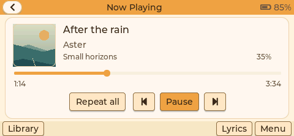
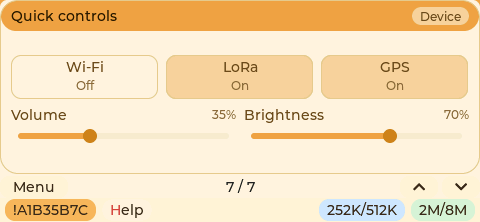
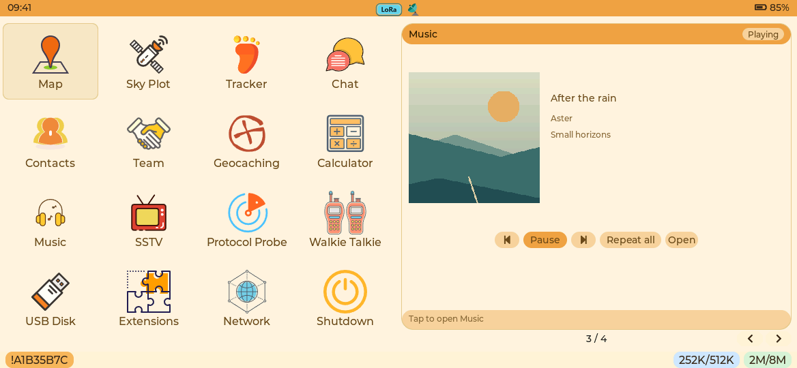
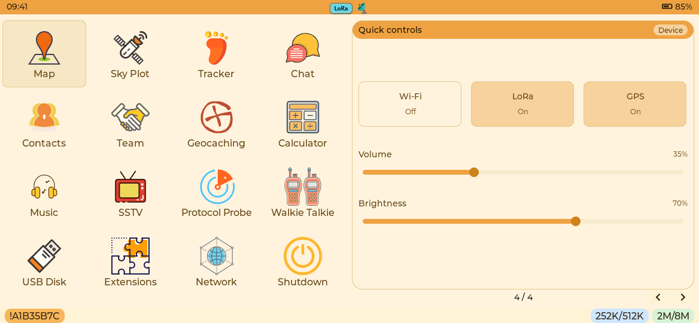

# Music and device controls

Music uses the existing warm palette, top bar and bottom-bar navigation. Opening
Music with a playing, paused or interrupted session opens Now Playing. Otherwise
it opens the SD library. Songs, artists, albums and folders are indexed on SD;
playlists are editable M3U8 files under `/.trailmate/music/playlists`. Song files
are never deleted by a playlist operation.

Now Playing includes embedded artwork, title, artist, album, elapsed/total time,
seek, previous/pause/next and repeat-all/repeat-one/shuffle. The artwork frame and
seek knob have disjoint bounds on every supported screen. The track-information
view pages through six ID3 fields at a time and keeps the cover visible. Lyrics
use three lines with synchronized LRC selection or manual scrolling.

## Ownership and resource lifetime

`core_music` owns storage/catalog/playback policy without LVGL or board code.
`music_image` adapts the firmware's existing JPEG/PNG codecs. ESP storage/audio
adapters reuse the shared SD runtime and each board's existing audio owner.
The full page and dashboard widget have independent PSRAM state and use one
serialized music service. Menu widgets leave before the next app attaches.

An idle music widget attaches with zero library rows: it does not scan SD,
allocate a decoder or start a playback task. Only the visible view requests
artwork/lyrics. Hiding it drops its image reference, cancels further decoding,
closes lyric files and releases its UI state. Exiting library browsing cancels
an unfinished index scan. A paused, hidden session keeps a compact resume record;
its decoder, file handles, published snapshot and worker are released. A media
session change invalidates that record. User-requested background playback
continues independently of widget visibility.

ESP bulk allocations require `MALLOC_CAP_SPIRAM | MALLOC_CAP_8BIT` without an
internal-RAM fallback: decoder/input/PCM workspace, indexes, scan tables,
command slots, service snapshots, lyrics, cover pixels and UI state. Decoder
workspace is 35,864 bytes in the host size check. Catalog scans use bounded
tables for 512 groups per category and a fixed-depth directory stack; complete
indexes are committed by switching CRC-protected SD manifest lanes. Song paging
reads only the requested fixed-size records. Playlist and catalog reads pump
audio between bounded batches instead of holding a second PCM cache.

Internal RAM still holds the small service proxy, lock/atomic control words,
RTOS task stacks and the existing hardware DMA buffers. ESP cache/flash and DMA
constraints make these distinct from bulk PSRAM storage. The music worker is
created only when work exists and exits while idle. It uses a 4 KiB stack;
individual P4 SDK stack-usage reports are build evidence, not measured runtime
high-water marks or a claim of zero internal-RAM cost. Artwork reference counts
use an internal critical-section lock because Xtensa native CAS cannot operate
on external-RAM objects.

## Audio focus

Voice messages, walkie-talkie, calls, alerts and SSTV reserve higher-priority
focus before touching the codec. Music acknowledges only after its hardware
lease has closed; opening and active state are published by the output port.
Nested owners must all release before music may resume. Manual pause/stop clears
the user's play intent. Selecting another song while paused preserves pause.
An interruption during PCM output remains an interruption, rather than turning
into a permanent playback error. Optional index/artwork/lyric I/O waits while a
higher-priority owner is active. Driver teardown and SD closure do not run under
the UI snapshot publication mutex.

User media/alert gain has one cached notification path shared by settings and
music. Queued stale volume commands cannot overwrite a newer user gain. P4 call
gain is session-scoped: initializing a call at 100% does not overwrite the
user's media/notification preference, and changing that preference does not
silently change a call's independent stream gain.

## Quick controls

The widget projects existing runtime state and submits bounded intents. It owns
no radio, GPS, codec, task or persistent timer. Five coalescing control words are
consumed one at a time by the existing application service loop outside LVGL.
Sliders commit on release or keyboard adjustment, so pointer movement does not
write flash. A slider owns its whole drag and cannot page the dashboard.

| Control | Owner and transition |
| --- | --- |
| Wi-Fi | Preserve saved profiles and priority. Coordinate transport clients before stopping the driver. Reject changes during OTA, calls, non-preemptible operations or external-storage suspension. Roll back a rejected preference; preserve initialization state after failed driver cleanup so retry is possible. |
| LoRa | A shared RF-permission policy is separate from mesh-protocol TX/RX configuration and temporary exclusive sessions. Reject a switch during an exclusive session. Reject new TX while disabled, finish current work and enter checked standby before acknowledging Off. Re-enable through the radio task; an uninitialized disabled radio can still be enabled. Preserve shared power rails. |
| GPS | Use the existing configuration edit lease, GPS runtime enable operation and position projection. The user preference is separate from normal duty-cycle sleep and temporary power leases. |
| Volume | Use the shared music/speaker volume. An idle adjustment updates the cached preference without creating a decoder, opening SD or starting a worker. Active playback defers flash persistence until audio is idle. |
| Brightness | Map the percentage to the target's actual brightness range, apply through its device port and persist that native level. |

Switching/failed/unavailable states are explicit. A failed switch retains its
actual enabled value for rendering and retry; a desired value is not treated as
a hardware acknowledgment. Hiding this widget never changes user preferences.
The empty generic card footer is removed; an error message appears only when
there is an error. Pager uses 1/2/3 for Wi-Fi/LoRa/GPS, +/- for volume and [/] for
brightness. W/A/S/D and the encoder retain their navigation roles.

P4 compass visibility owns a balanced heading lease. The final release stops
sampling, powers down the private magnetometer/IMU interface, removes its I2C
handles and ends the worker after its current bounded operation. It does not
disable the external shared 3V3 rail.

## Supported media and verification

The decoder streams MPEG Layer III at native sample rates and downmixes to mono.
ID3v1 and ID3v2.2/2.3/2.4 cover common and extended text, comments, attached
pictures and embedded lyrics. UTF-8/Latin-1/UTF-16 and separate WXXX description/
URL encodings are handled. Unsupported compressed/encrypted/global-unsync tag
content is reported rather than decoded as ordinary text. The audio payload can
still be used when an unsupported tag format can be safely skipped.

JPEG decoding streams into an aspect-preserving RGB565 thumbnail with bounded
scratch and cooperative cancellation. PNG uses a bounded transient decode with
the strict PSRAM allocation lease. Encoded limits are 2 MiB JPEG and 256 KiB PNG;
PNG also has a 512-pixel edge and 147,456-pixel raster limit. Progressive JPEG is
not supported by the bundled decoder. Only the thumbnail is retained. Lyrics
index at most 64 KiB and 512 lines. Long/unsupported fields report limits instead
of retaining an entire tag or full-size cover.

`tests/music` runs real decoding, parser, artwork codec, catalog/playlist recovery,
focus and playback policy tests. Its device-controls target compiles the actual
production coordinator against observable hardware/configuration ports. The
native LVGL suites cover all five panels, seek/artwork geometry, mode cycling,
playlist creation, widget teardown, Enter routing and slider gesture ownership.
Preview screenshots use explicit deterministic fixtures; they are not evidence
of physical audio quality, bus timing, PSRAM peaks or real-device latency.

## Actual LVGL captures

The following captures use the production page/widget code and deterministic
preview services. Top-bar memory values and media metadata are fixture data.

