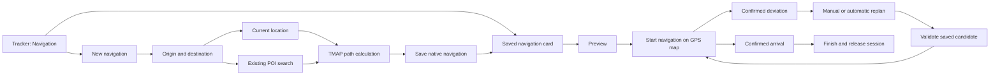

# Tracker: origin-to-destination navigation

Status: the ESP runtime, Tracker filter, shared POI endpoint form, native
`.tmroute` save/preview and Map navigation lifecycle are integrated. The real
production worker and LVGL consumers pass host tests with Center's 20.779 km
London route; a Wio L2 firmware build passes. Physical-device navigation and
resource acceptance remain separate from these results. See the detailed
[implementation and evidence](../../engineering/native-navigation.md).

## User flow

Tracker keeps its Tracks and Routes filters and adds Navigation. The new filter
shows saved navigation plans using the existing single-card previous/next
interaction. A New navigation action is available even when there are no plans.

Creating a navigation opens an origin/destination form. The origin defaults to
Current location; its coordinates are resolved from a valid GPS fix when the
user requests calculation. Tapping either endpoint opens
the existing `ui::components::map_poi_search` picker. Its selected POI supplies
the endpoint coordinates and display name. Typing a place name does not itself
choose coordinates. Returning from search preserves the other endpoint.

Calculate produces a road/path route through the installed TMAP routing data.
The UI remains responsive and offers cancellation while calculation runs. The
result reports its distance and enables Save and preview. Saving opens the
existing route preview with the computed path and distance. The user can change
endpoints before saving or load the saved plan for navigation. A saved plan can
later be previewed, navigated or deleted from its
Tracker card. Saving retains computed geometry, cumulative distances and indexes;
the filename contains bounded endpoint names. Original POI metadata and semantic
maneuvers are not embedded. Opening does not recalculate its origin from a new fix.

Starting navigation activates the computed path in the existing GPS map.
Current position, remaining route distance, route progress, geometry-turn hints,
confirmed deviation and arrival use the indexed native reader. Stopping navigation ends
the active session without deleting the saved plan. Cards and endpoint fields
prefer place names, administrative area and distance over raw coordinates.

The Map taskbar also offers Menu > Navigation management for access to saved
plans. Team has its own separate upward menu; see [Map taskbar](map_taskbar.md).

The native Navigation dialog exposes Replan from here, Reload route, Automatic
replan and a fixed Stop navigation footer. Cancel/Retry replace the replan action
as state changes. Automatic replanning requires a fresh confirmed deviation;
failed/cancelled candidates leave the saved route intact. A new candidate is
opened before active-route configuration changes. Arrival clears active route
configuration and offers Finish navigation. Stop/Finish do not delete files.
The dialog recovers keyboard focus when Cancel changes meaning; the touch footer
remains at least 44 px high outside the scrolling body. Following runs while Map
is open and resumes the saved active path on reentry.

## Route Preview keyboard controls

T-LoRa Pager can operate the preview without touch or symbol-key combinations.
Press **H** (or **?**) to open Preview Help. The dialog lists these shortcuts;
use **W/S** to scroll it and **H**, **X**, Enter or Back to close it.

| Key | Action |
| --- | --- |
| W / A / S / D | Move the view up / left / down / right, 40 pixels per key event |
| Q / E | Zoom out / in, matching the Map page |
| F | Fit the whole route and clear the manual pan offset |
| R | Load or unload the selected route |
| L | Change the base map layer |
| V | Show or hide the elevation profile |
| G | Download route images |
| P | Show or hide the image strip |
| W / S, with images shown | Select the previous / next image instead of moving the map vertically |
| Enter, with images shown | Open or close the selected image |

Hide the image strip with **P** before using all four movement keys. Close a
fullscreen image with Enter or Back before controlling the map. Arrow keys
remain available on devices that provide them; **+ / =** and **− / _** also
zoom. Letter shortcuts accept either case. Preview uses **G** for downloads and
**V** for the profile so **D** and **E** can retain their Map movement/zoom roles.

## Integration boundaries

- Reuse `map_poi_search::open` and its existing selection callback for endpoint
  entry. Do not introduce another POI search implementation or dataset.
- Keep path calculation independent of LVGL and Tracker state. The TMAP SDK
  already supplies `beginIntegerCoordinateRoute`, incremental routing steps
  and streamed integer-route geometry. The application supplies bounded
  working storage and a platform file adapter.
- Check routing capability and endpoint coverage in installed packages. A map
  that renders tiles or supports POI search does not necessarily contain a
  road graph. Explain missing routing data or no path; never draw a straight
  line and present it as a calculated route.
- Persist `.tmroute` plans through an exclusive SD spool and phased export. The
  Map native reader draws only indexed viewport geometry; its draw callback
  performs no SD I/O and keeps a fixed screen snapshot.
  Generated navigation is local data, not an automatically published trail.
- Install Center's generated SD tree, including detailed OSM packages under
  `/maps/tmap/osm`. Navigation data can be embedded in that package. Saved plans
  live in `/routes/navigation` and have filenames
  containing bounded origin/destination names plus an identifier. A raster-only
  map is insufficient. This first device integration uses the foot profile and
  one package per route; compose regional source data in Center for routes that
  need a connected graph across region boundaries. Packages requiring runtime
  conditional-rule evaluation are not supported by this integration.
- Allocate the SDK package workspace, search labels and route output only
  while needed, in PSRAM on capable ESP targets. Release planning buffers
  after save/cancel; do not keep another graph cache or worker stack alive
  while Tracker is idle. Stream geometry into storage instead of retaining
  the complete road network or a second full path in internal RAM.
- Keep existing recording, imported routes and shared-trail behavior intact.
  Add firmware locale strings through the existing packs for the supported
  languages.

## Acceptance

Verify current-position and searched origins, searched destinations, returning
from the common picker, successful road-graph calculation and map rendering,
save/reopen across restart, start/stop route following, and ordinary missing
GPS/routing-data/no-path feedback. Check touch and keyboard/card navigation at
the existing firmware sizes. Measure internal RAM before creating a plan,
during calculation and after cancellation/completion. This feature requires a
new firmware candidate; the previously consumed final flash is not reusable
without another device upload opportunity.

Native checks are `tests/navigation` (SDK/pipeline and the actual production
worker with host RTOS/SD ports) and `tests/navigation_ui` (actual LVGL dialog,
native preview/Map reader, controls and session policy). The 20,778.62 m London
route produces a 43,776-byte archive. All 1,170 geometry endpoints match in UI
replay; eight fitting viewports are pixel-identical to full-geometry host drawing.
Four dense overview views request zooming in; all tested z16/z18 views fit.

The worker's external allocation payload peak is 2,143,140 B on 32-bit MinGW.
Map's owner is 1,576 B and its separate reader payload 2,160 B. These figures
exclude physical driver/allocator overhead, task stack, display and other
features. Host tests do not drive the entire GPS-page global state through
physical input, or establish MCU timing, SD latency or physical memory peaks.
