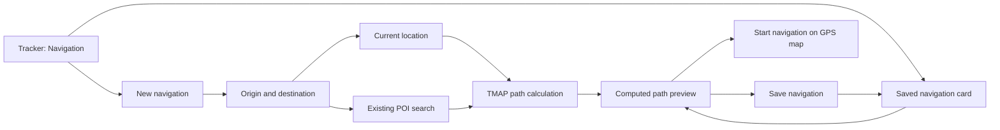

# Tracker: origin-to-destination navigation

Status: the ESP runtime, Tracker filter, shared POI endpoint form, KML save and
existing map-preview/load integration are implemented. Focused calculation,
serialization and native LVGL dialog tests pass; the changed sources also pass
Wio L2 toolchain syntax validation. Physical navigation acceptance is pending.

## User flow

Tracker keeps its Tracks and Routes filters and adds Navigation. The new filter
shows saved navigation plans using the existing single-card previous/next
interaction. A New navigation action is available even when there are no plans.

Creating a navigation opens an origin/destination form. The origin defaults to
Current location; its coordinates are resolved from a valid GPS fix when the
user requests calculation. Tapping either endpoint opens
the existing `ui::components::map_poi_search` picker. Its selected POI supplies
the endpoint coordinates and display name. Typing a place name does not itself
choose coordinates. Returning from search preserves the other endpoint.

Calculate produces a road/path route through the installed TMAP routing data.
The UI remains responsive and offers cancellation while calculation runs. The
result reports its distance and enables Save and preview. Saving opens the
existing route preview with the computed path and distance. The user can change
endpoints before saving or load the saved plan for navigation. A saved plan can
later be previewed, navigated or deleted from its
Tracker card. Saving preserves the selected endpoints and computed geometry;
opening an existing plan does not silently replace its origin with a new fix.

Starting navigation activates the computed path in the existing GPS map.
Current position, remaining route distance, route progress, deviation and
arrival use the existing route-following facilities. Stopping navigation ends
the active session without deleting the saved plan. Cards and endpoint fields
prefer place names, administrative area and distance over raw coordinates.

The Map taskbar also offers Menu > Load navigation for direct access to saved
plans. Team has its own separate upward menu; see [Map taskbar](map_taskbar.md).

## Integration boundaries

- Reuse `map_poi_search::open` and its existing selection callback for endpoint
  entry. Do not introduce another POI search implementation or dataset.
- Keep path calculation independent of LVGL and Tracker state. The TMAP SDK
  already supplies `beginIntegerCoordinateRoute`, incremental routing steps
  and streamed integer-route geometry. The application supplies bounded
  working storage and a platform file adapter.
- Check routing capability and endpoint coverage in installed packages. A map
  that renders tiles or supports POI search does not necessarily contain a
  road graph. Explain missing routing data or no path; never draw a straight
  line and present it as a calculated route.
- Persist plans and their KML route geometry on SD. Reuse existing map route
  rendering and route-following integration after calculation completes.
  Generated navigation is local data, not an automatically published trail.
- Install Center-produced `navigation.tmap` files in `/maps/navigation` or
  `/maps/tmap/navigation`; existing `/maps/tmap` packages are also checked for
  routing data. Saved plans live in `/routes/navigation` and have filenames
  containing bounded origin/destination names plus an identifier. A raster-only
  map is insufficient. This first device integration uses the foot profile and
  one package per route; compose regional source data in Center for routes that
  need a connected graph across region boundaries. Packages requiring runtime
  conditional-rule evaluation are not supported by this integration.
- Allocate the SDK package workspace, search labels and route output only
  while needed, in PSRAM on capable ESP targets. Release planning buffers
  after save/cancel; do not keep another graph cache or worker stack alive
  while Tracker is idle. Stream geometry into storage instead of retaining
  the complete road network or a second full path in internal RAM.
- Keep existing recording, imported routes and shared-trail behavior intact.
  Add firmware locale strings through the existing packs for the supported
  languages.

## Acceptance

Verify current-position and searched origins, searched destinations, returning
from the common picker, successful road-graph calculation and map rendering,
save/reopen across restart, start/stop route following, and ordinary missing
GPS/routing-data/no-path feedback. Check touch and keyboard/card navigation at
the existing firmware sizes. Measure internal RAM before creating a plan,
during calculation and after cancellation/completion. This feature requires a
new firmware candidate; the previously consumed final flash is not reusable
without another device upload opportunity.

Native checks are `tests/navigation` (real SDK routing and saved KML) and
`tests/navigation_ui` (the production dialog with fake GPS/storage/POI ports).
The latter checks both current-GPS and searched origins, destination selection,
the ready/save/preview callback, fixed touch cancellation and input-group/lease
restoration. It does not exercise SD I/O, real POI search or physical touch.

On 2026-10-15 a separate host probe used the same RouteCalculation and KML
writer with Center's real Monaco foot/1 KiB/ALT4 package. It calculated a
571 m route with 21 legs and streamed 60 geometry points to KML. The SDK memory
provider peaked at 150,200 bytes and released its allocations on reset. These
are host measurements for this route, excluding platform SD/LVGL overhead;
they are not physical-device memory or performance measurements.
